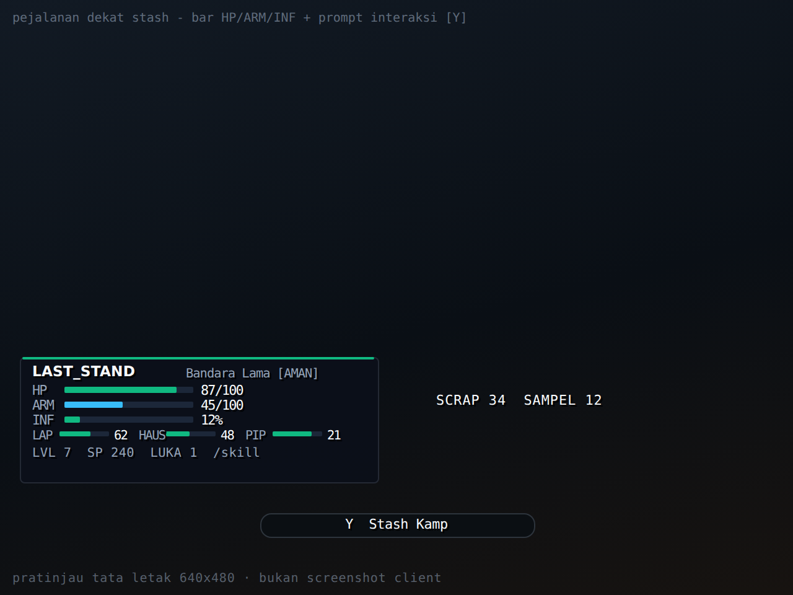
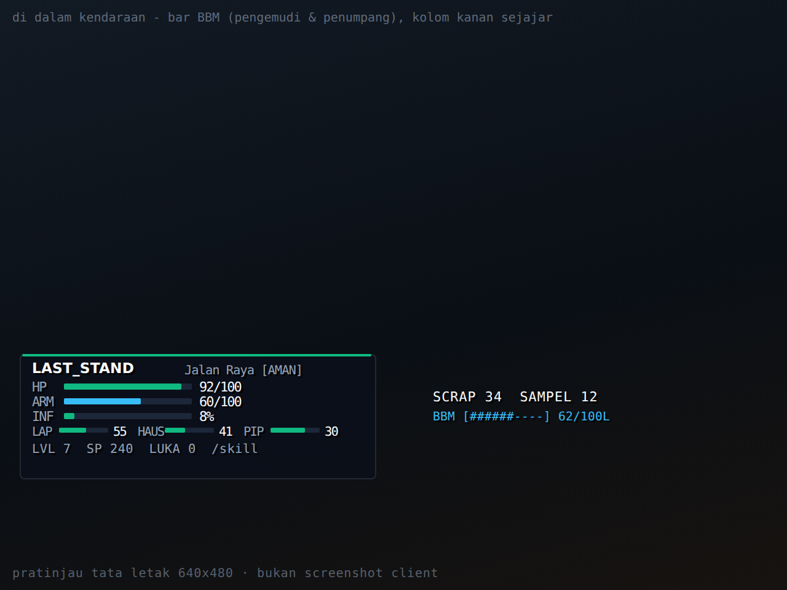
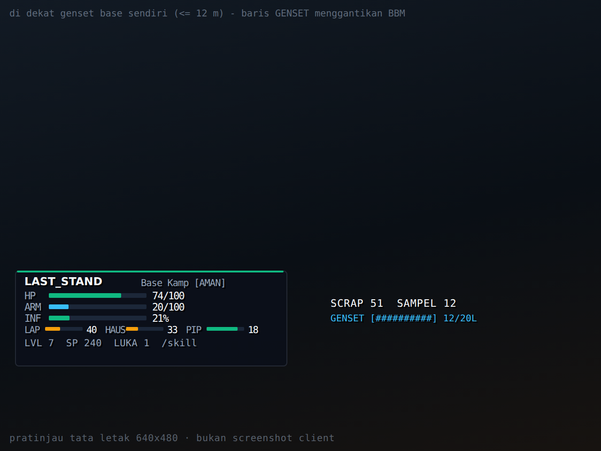
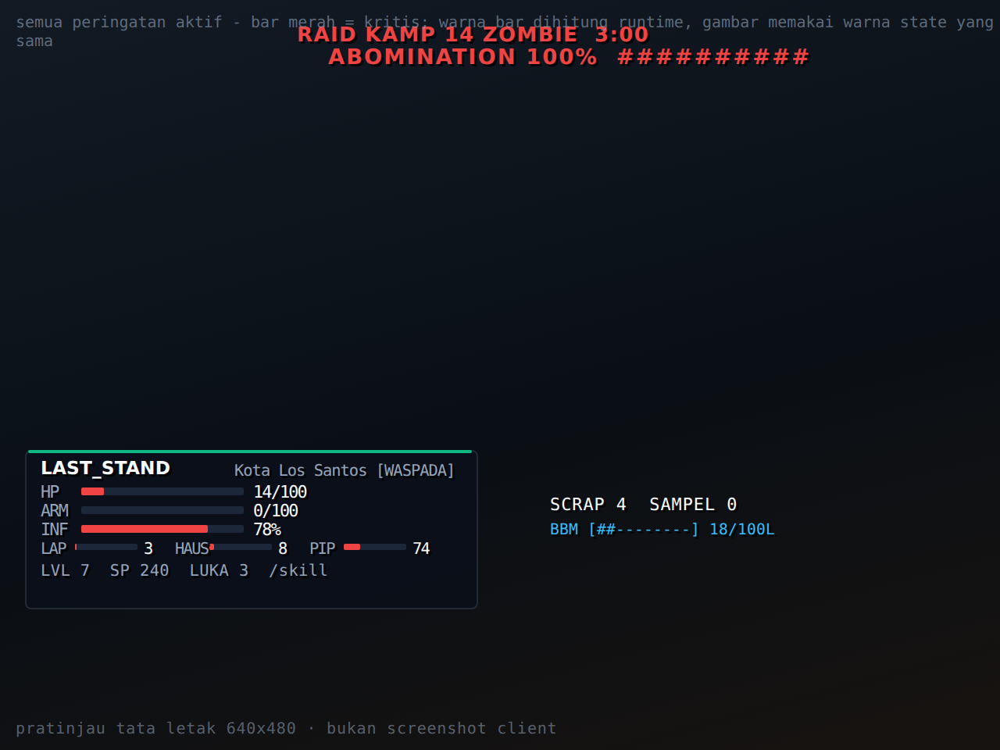
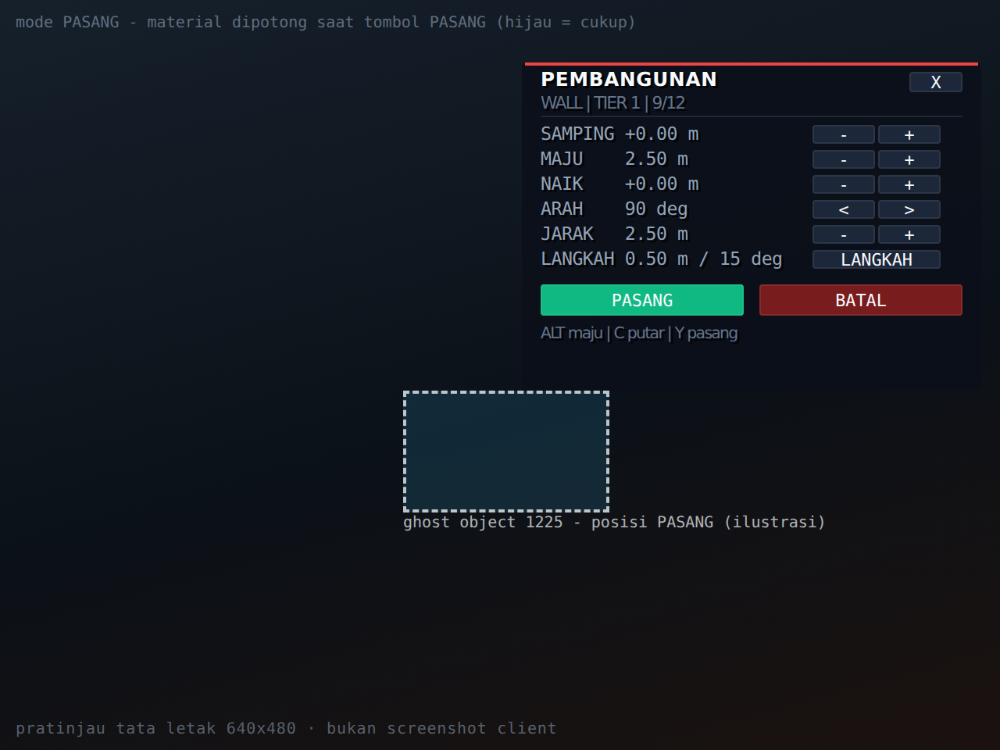
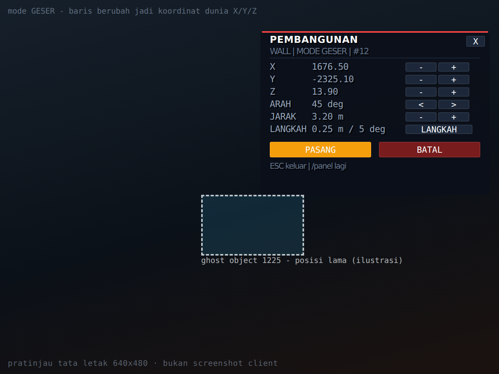
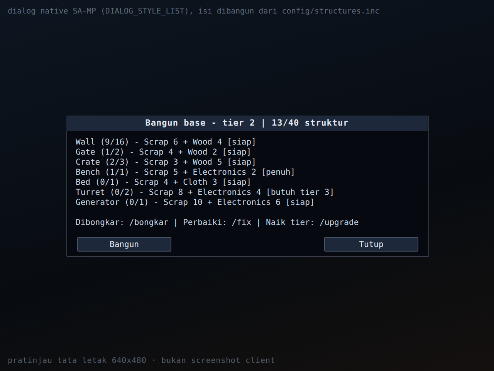
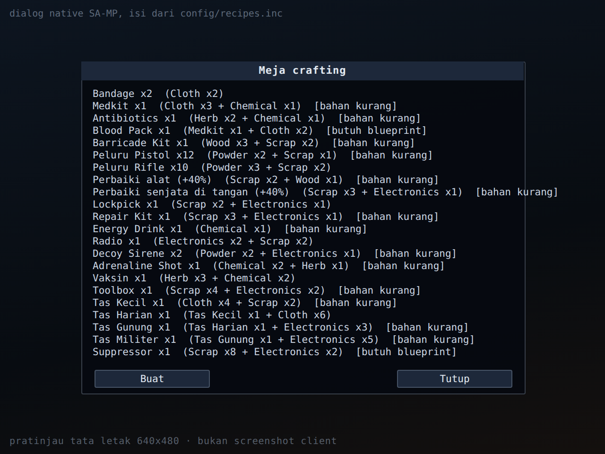
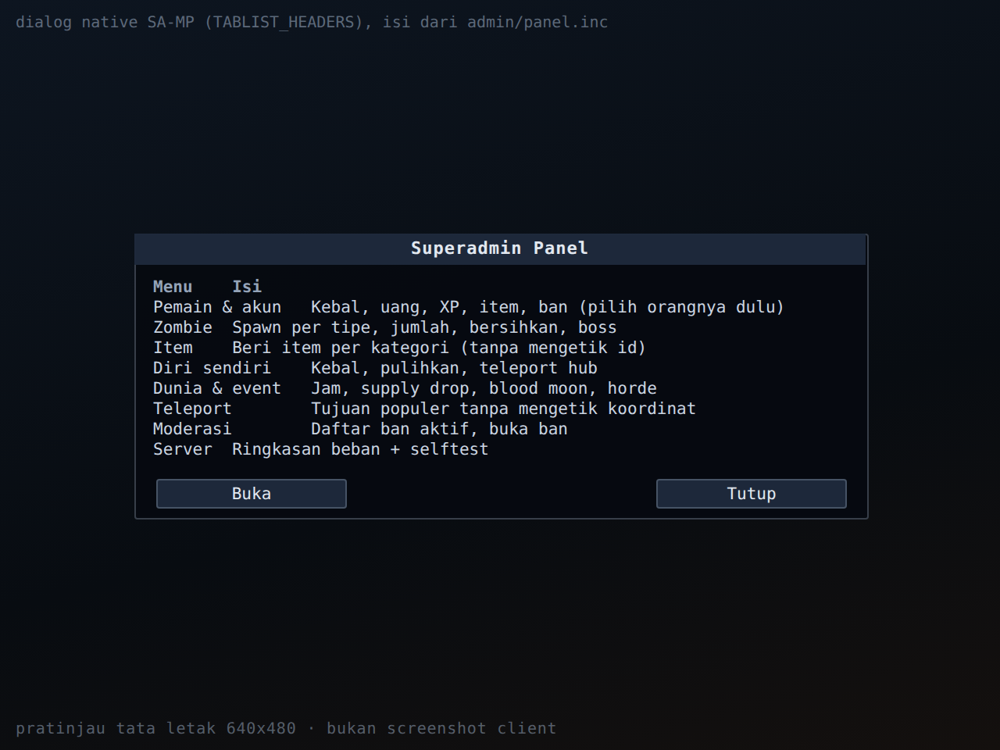
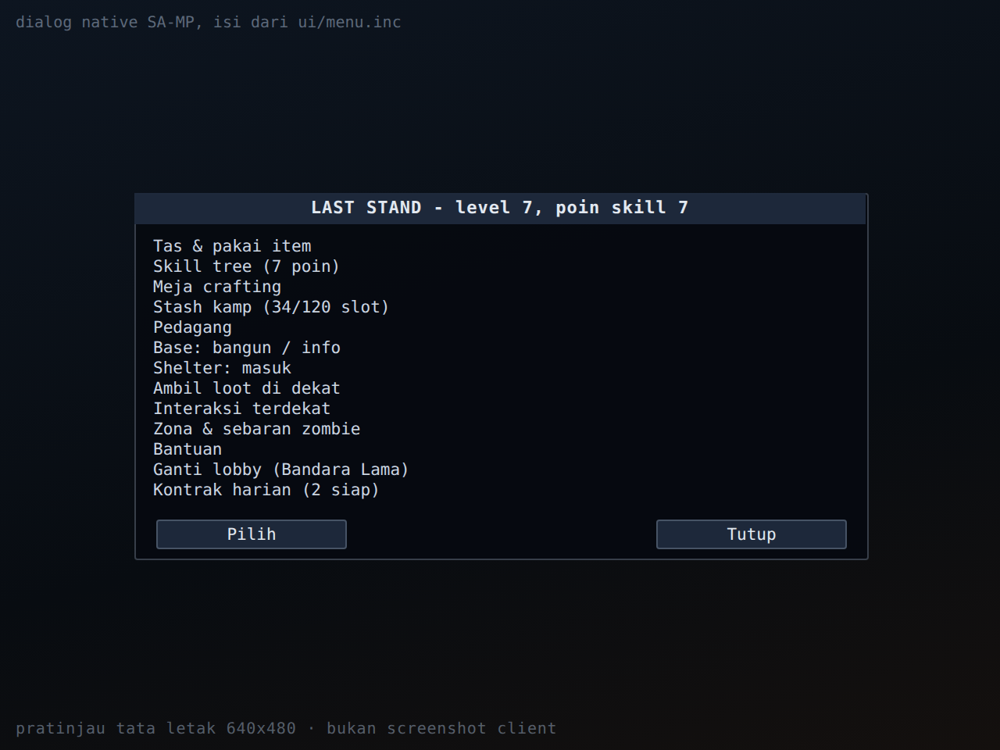

# Galeri UI / UX / TextDraw — LAST STAND

Kumpulan gambar tata letak antarmuka yang dipakai server ini. Semua dirender ulang
dari kode PAWN yang benar-benar berjalan (`gamemodes/modules/`), bukan digambar
manual — jadi kalau kode UI berubah, gambar di sini bisa dibuat ulang dan
perbedaannya terlihat.

**Penting:** ini **pratinjau geometri**, bukan screenshot client GTA:SA. Metrik
glif dan bayangan diperkirakan (`CHAR_ADVANCE_RATIO 35.3`, `LINE_HEIGHT_RATIO 10.5`
— sama dengan gate HUD), dan ilustrasi *ghost object* hanya penanda posisi.
Yang divalidasi adalah angka: posisi, ukuran, lebar teks terburuk, dan hitbox.

Resolusi: 1280×960 (2× dari koordinat asli 640×480 SA-MP).

## TextDraw (komponen yang dirender server)

| Gambar | Isi | Sumber kode |
|---|---|---|
|  | Kartu kaca rounded: bar HP/ARM/INF berlabel + angka, micro-bar LAP/HAUS/PIP, zona di baris brand, pil prompt `Y  Stash Kamp` | `ui/hud.inc` |
|  | Baris BBM aktif untuk pengemudi **dan** penumpang; kolom kanan SCRAP/SAMPEL + BBM segaris (x=352, lebar 276) | `ui/hud.inc` |
|  | Saat tidak di kendaraan tapi ≤ 12 m dari genset base sendiri, baris BBM berganti jadi `GENSET [##########] 12/20L` | `ui/hud.inc` + `BaseBuild_GeneratorSlot` |
|  | Semua peringatan aktif: bar HP/INF merah, ARM kosong, kebutuhan hampir habis, boss, raid | `ui/hud.inc` |
|  | Panel bangun mode **PASANG**: SAMPING/MAJU/NAIK/ARAH/JARAK/LANGKAH, tombol sprite, PASANG hijau = material cukup | `world/build_edit.inc` |
|  | Panel bangun mode **GESER**: tiga baris atas berubah jadi koordinat dunia X/Y/Z, PASANG kuning | `world/build_edit.inc` |

## Dialog native SA-MP (bukan TextDraw)

Dialog adalah komponen bawaan client (`ShowPlayerDialog`), jadi tidak bisa
dirender sebagai TextDraw. Gambar di bawah adalah mock dengan **isi yang benar**
hasil membaca config, diberi keterangan bahwa itu dialog native.

| Gambar | Isi | Sumber |
|---|---|---|
|  | Daftar struktur: biaya, sisa limit, status (`siap`/`penuh`/`butuh tier N`) | `world/base_build.inc` + `config/structures.inc` |
|  | 22 resep dengan bahan + penanda blueprint/bahan kurang | `ui/craft_ui.inc` + `config/recipes.inc` |
|  | Panel superadmin TABLIST_HEADERS | `admin/panel.inc` |
|  | 13 pintu masuk sistem (tas, skill, craft, stash, base, shelter, kontrak…) | `ui/menu.inc` |

## Aturan desain yang dipakai

- **Satu tombol = satu sprite selectable** (`LD_SPAC:white` / `LD_BEAT:chit`) plus
  label *non*-selectable. Label yang ikut selectable membuat kursor berebut
  hitbox (kuirk hitbox terpusat GTA SA).
- **Kartu rounded dari 6 sprite**: 2 strip + 4 sudut `LD_BEAT:chit`.
  `PlayerTextDrawBoxColor` selalu tajam, tidak dipakai untuk kartu.
- **Tidak ada panel di area HUD kiri** (x < 300) maupun di bawah y = 330, supaya
  baris `SCRAP`/`BBM` tidak tertimpa.
- **Warna**: latar `UI_BG_GLASS_DARK 0x0B0F19E6`, teks `UI_TEXT_PRIMARY`,
  aksen `UI_ACCENT_PRIMARY/WARN/DANGER` — satu bahasa warna untuk seluruh UI.
- **Teks terburuk**, bukan contoh pendek: setiap panel diuji dengan string
  maksimum yang mungkin muncul sebelum dianggap lulus.

## Gate yang menjaga gambar ini tetap jujur

| Gate | Berkas | Yang gagal |
|---|---|---|
| Lebar HUD 640 px | `tools/hud_preview/generate.py` | baris HUD meluber / tabel `gHudFitRows` basi |
| Geometri panel bangun | `tools/hud_preview/build_panel.py` | koordinat panel/tombol berubah tanpa alat diperbarui |
| Selftest runtime | `core/selftest.inc` | `Selftest_CheckBuildEdit`, `Selftest_CheckBuildPanel` (53/53 PASS) |

## Cara membuat ulang

```bash
python3 tools/tdui/gallery.py            # render ulang semua PNG
python3 tools/tdui/gallery.py --no-shoot # hanya HTML, tanpa Chrome
```

Skrip ini **gagal (exit 1)** kalau literal koordinat di `build_edit.inc` atau
baris dialog di `admin/panel.inc` / `ui/menu.inc` tidak lagi cocok, supaya galeri
tidak pernah menampilkan tata letak yang sudah tidak ada di kode.
